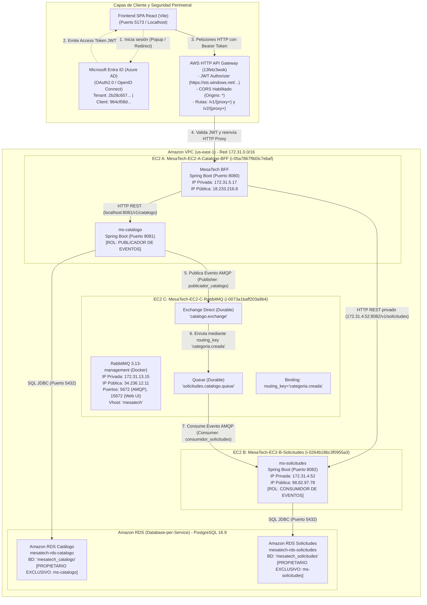

# Diagrama de Despliegue y Arquitectura Real de MesaTech Cloud (EP2)
**Integrantes:** Francisco Torres — Kevin Mesías  
**Asignatura:** Desarrollo Cloud Native I (DSY1107) — Evaluación Parcial 2

---

## 1. Diagrama de Arquitectura Completo (Mermaid)

---

## 2. Matriz de Responsabilidad, Publicación y Propiedad de Datos

| Componente | Rol en Mensajería | Rol de Datos / Persistencia | Acceso de Red / Puertos |
|---|---|---|---|
| **ms-catalogo** (EC2 A) | **PUBLICADOR (Publisher)**: Emite el evento `CategoriaCreadaEvent` al exchange `catalogo.exchange` usando el usuario `publicador_catalogo`. | **PROPIETARIO EXCLUSIVO** de `RDS Catálogo` (`mesatech_catalogo`). Guarda y mantiene las categorías maestras y prioridades. | Puerto 8081 accesible solo internamente dentro de la VPC por el BFF. |
| **ms-solicitudes** (EC2 B) | **CONSUMIDOR (Consumer)**: Escucha la cola `solicitudes.catalogo.queue` con el usuario `consumidor_solicitudes` y procesa el evento con ACK. | **PROPIETARIO EXCLUSIVO** de `RDS Solicitudes` (`mesatech_solicitudes`). Guarda las solicitudes de soporte y la copia local de categorías para integridad referencial. | Puerto 8082 accesible solo internamente dentro de la VPC por el BFF. |
| **RabbitMQ** (EC2 C) | **BROKER DE MENSAJERÍA**: Administra el Virtual Host `mesatech`, almacena los mensajes de forma durable en disco (`mesatech_rabbitmq_data`). | **NO GUARDA DATOS DE NEGOCIO**. Solo retiene temporalmente los mensajes hasta su consumo exitoso. | Puerto 5672 interno (AMQP) y puerto 15672 público (Web Management). |
| **BFF** (EC2 A) | **COORDINADOR / GATEWAY**: No participa directamente en la mensajería AMQP. | **SIN BASE DE DATOS**. El BFF no accede a ninguna base de datos; coordina llamadas REST a los microservicios. | Puerto 8080 público hacia API Gateway. |
